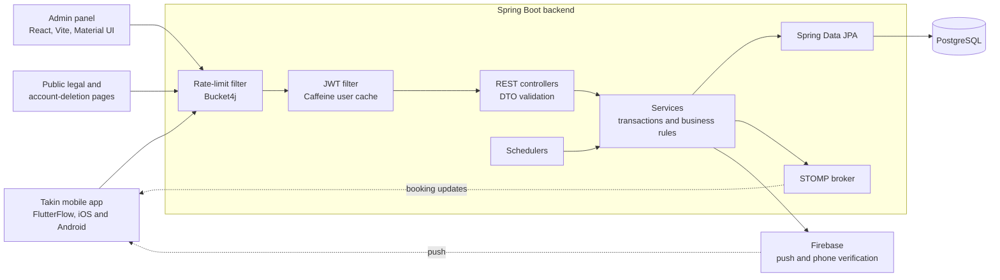
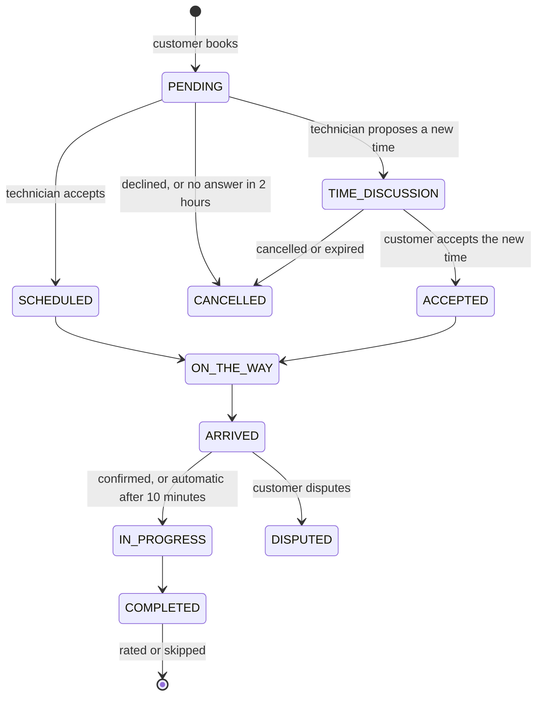

# Takin (formerly ChikChak)

> [!IMPORTANT]
> **Takin and ChikChak are the same project.** The product started out as ChikChak and was later renamed **Takin**, the name it is published under on Google Play and the App Store. This repository (`chikchak-backend`) and the code inside it (for example the `com.chikchak` package) kept the original name. If you came here from a CV or job application that mentions **Takin**, you are in the right place.


Takin is a mobile marketplace that connects people in Israel with verified home-service professionals: plumbers, electricians, AC technicians, movers, cleaners and more. Customers find a professional nearby, book a time slot, chat, follow the job to completion and leave a rating. Professionals receive requests, negotiate times and run their jobs from the same app.

**The app is live on Google Play and the Apple App Store.** This repository contains its backend API and its admin web panel.

## At a glance

| | |
|---|---|
| **Status** | In production, published on Google Play and the App Store |
| **My role** | Solo developer: backend, database, admin panel, mobile app, deployment and store releases |
| **Backend** | Java 17, Spring Boot 3.2, Spring Security, Spring Data JPA / Hibernate, PostgreSQL |
| **Real time and push** | WebSocket / STOMP, Firebase Cloud Messaging |
| **Admin panel** | React 19, Vite, Material UI |
| **Mobile app** | FlutterFlow (iOS and Android), built on this API and kept outside this repository |
| **Infrastructure** | Docker, Railway |
| **Size** | 80+ REST endpoints, 17 JPA entities, 45+ merged pull requests |

## Where to look first

| If you are hiring for | Start here |
|---|---|
| **Backend** | [`BookingService`](src/main/java/com/chikchak/service/BookingService.java) for the domain logic, the [`security`](src/main/java/com/chikchak/security) package for the request pipeline, and [`ChatRepository`](src/main/java/com/chikchak/repository/ChatRepository.java) with the [index migration](db/migrations/2026-06-16__add_performance_indexes.sql) for query tuning |
| **Full stack** | [`admin-panel`](admin-panel) (React routing, auth, API client) next to the [`AdminService`](src/main/java/com/chikchak/service/AdminService.java) behind it, and [`JacksonConfig`](src/main/java/com/chikchak/config/JacksonConfig.java), where API responses are shaped for the mobile client |
| **Software engineering** | [Engineering highlights](#engineering-highlights) for the decisions behind the code, then the [merged pull requests](https://github.com/muhammadtaha211/chikchak-backend/pulls?q=is%3Apr+is%3Amerged) |

## What it does

**Customers**
- Search approved professionals by service and location, with or without an account
- Book a two-hour time slot, accept a counter-proposed time, or cancel
- Follow the job through every stage, chat with the professional and rate the work afterwards
- Block or report other users, and delete their own account and data

**Professionals**
- Sign up and appear in search only after an admin approves them
- Accept, decline or counter-propose a time for each request
- Move a job through its stages, from on the way to completed
- Control their availability, service radius and profile, and review their job history

**Admins** (web panel)
- Approve or reject professionals, suspend or reactivate users
- Search bookings, and cancel or override one that is stuck
- Review user reports and remove content
- See every admin action in an audit log

## Architecture



A conventional layered design: controllers validate and delegate, services own transactions and business rules, repositories hold the queries. Entities never leave the service layer. Requests and responses are DTOs, most of them mapped with MapStruct.

| Area | Path | Access |
|---|---|---|
| Auth and account | `/api/auth` | Public and signed-in |
| Bookings | `/api/bookings` | Signed-in |
| Customer | `/api/customer` | Customer |
| Technician | `/api/technician` | Technician |
| Chat | `/api/chat`, `/ws` | Signed-in |
| Ratings | `/api/ratings` | Signed-in |
| Moderation | `/api/moderation` | Signed-in |
| Push devices | `/api/user` | Signed-in |
| Admin | `/api/admin` | Admin |
| Guest and public | `/api/public` | Public |

## Engineering highlights

### Booking lifecycle

The main path through the 12 booking statuses:



- **Rules live on the server.** A customer can have one active booking at a time, only approved and available professionals can be booked, and people who have blocked each other cannot book or message each other.
- **Negotiating a time is safe on a stale screen.** To accept a proposed time, the client sends back the time the customer actually saw. If the professional changed it in the meantime, the request is rejected instead of confirming the wrong slot.
- **Schedulers close the gaps.** Requests nobody answers are cancelled after two hours, stale time proposals expire, and an arrival nobody confirms moves on after ten minutes.

Code: [`BookingService`](src/main/java/com/chikchak/service/BookingService.java), [`BookingTimeoutScheduler`](src/main/java/com/chikchak/service/BookingTimeoutScheduler.java), [`AutoConfirmScheduler`](src/main/java/com/chikchak/service/AutoConfirmScheduler.java)

### Cheap reads under constant polling

The mobile app stays current by polling, so the read path is tuned for it.

- **Fewer queries on hot paths.** The chat list uses a fetch join and one grouped unread count instead of a count query per chat. Technician badge counts come from a single grouped query, and marking a chat as read is one bulk update.
- **Indexes that match the queries.** 15 indexes cover the polled filters and sorts, shipped as an idempotent `CREATE INDEX CONCURRENTLY` migration that does not block writes on a live table.
- **Cheap authentication.** Each JWT is parsed and verified once per request, and the user lookup comes from a 30-second Caffeine cache that is evicted on suspension, deletion, and profile or password changes.
- **Short-lived connections.** `open-in-view` is off, so a database connection is held for the transaction and not while JSON is rendered. Pool and thread limits are set per environment.

Code: [`ChatRepository`](src/main/java/com/chikchak/repository/ChatRepository.java), [`BookingRepository`](src/main/java/com/chikchak/repository/BookingRepository.java), [`UserAuthCache`](src/main/java/com/chikchak/security/UserAuthCache.java), [index migration](db/migrations/2026-06-16__add_performance_indexes.sql)

### Security

- **Stateless JWT authentication** with BCrypt password hashing and role-based routes for customers, technicians and admins.
- **Layered rate limiting.** 5 attempts per 15 minutes per IP on login, registration and password reset, 60 writes per minute per IP, and 10 chat messages per minute per user. The per-IP limits run before authentication so failed logins count, and reads are never throttled so polling is unaffected.
- **Suspension reaches tokens that were already issued**, because account status is checked on every request.
- **Password reset** depends on a Firebase phone-verification token that the server verifies itself.
- **Safer defaults at the edge:** request size caps, HSTS and related headers, CORS allow-lists, a JWT required on the WebSocket `CONNECT` frame, and Swagger disabled in production.

Code: [`SecurityConfig`](src/main/java/com/chikchak/security/SecurityConfig.java), [`RateLimitFilter`](src/main/java/com/chikchak/security/RateLimitFilter.java), [`JwtAuthenticationFilter`](src/main/java/com/chikchak/security/JwtAuthenticationFilter.java), [`WebSocketAuthInterceptor`](src/main/java/com/chikchak/security/WebSocketAuthInterceptor.java)

### Privacy and app store compliance

- **Account deletion** works in the app and through a public form that needs no login. The account is anonymized instead of dropped, so the other party keeps their history.
- **No account probing.** The public form always gives the same answer whether or not the email is registered, and a honeypot field discards bot submissions.
- **Guest search carries no personal contact data.** Emails, phone numbers, addresses and exact coordinates are stripped from the results.
- **Blocking and reporting.** A block applies in both directions across search, booking and chat. Reports go to an admin review queue, and every admin write is recorded in an audit log.

Code: [`DataDeletionService`](src/main/java/com/chikchak/service/DataDeletionService.java), [`ModerationService`](src/main/java/com/chikchak/service/ModerationService.java), [`AdminService`](src/main/java/com/chikchak/service/AdminService.java)

### Built around its client and its market

- **Null-safe responses.** FlutterFlow does not cope well with nulls, so a custom Jackson modifier replaces null strings, numbers, booleans and lists with safe defaults in every response.
- **One response shape.** Every endpoint returns the same `ApiResponse<T>` envelope, and one global handler turns failures into consistent errors with field-level validation messages.
- **Dependable push.** Several devices per user, tokens reassigned when a phone changes accounts, and tokens Firebase reports as dead removed. Push failures are caught and logged so they do not interrupt a booking.
- **Location-aware search.** Great-circle distance is computed in the query and checked against each professional's own service radius.
- **Hebrew first.** System messages and notifications are in Hebrew, and the catalog of 104 job types is seeded in English, Hebrew and Arabic.
- **Correct local time.** The JVM is pinned to `Asia/Jerusalem` before Spring starts, because Hibernate and the JDBC driver capture the time zone at startup.

Code: [`JacksonConfig`](src/main/java/com/chikchak/config/JacksonConfig.java), [`GlobalExceptionHandler`](src/main/java/com/chikchak/exception/GlobalExceptionHandler.java), [`NotificationService`](src/main/java/com/chikchak/service/NotificationService.java), [`TechnicianProfileRepository`](src/main/java/com/chikchak/repository/TechnicianProfileRepository.java)

## Run it locally

You need JDK 17 or newer, PostgreSQL, and Node 18 or newer for the admin panel.

**Backend**

```bash
git clone https://github.com/muhammadtaha211/chikchak-backend.git
cd chikchak-backend
createdb -U postgres CC

export DB_PASSWORD=your-postgres-password
export JWT_SECRET=$(openssl rand -base64 64 | tr -d '\n')
export ADMIN_EMAIL=admin@example.com
export ADMIN_PASSWORD=choose-a-password
export ALLOWED_ORIGINS=http://localhost:5173

sh mvnw spring-boot:run        # Windows: mvnw.cmd spring-boot:run
```

The schema and the job catalog are created on first start. Firebase and SMTP are optional: without them, push notifications and emails are skipped. [`.env.example`](.env.example) lists every setting.

- Swagger UI: `http://localhost:8080/swagger-ui/index.html`
- Health check: `http://localhost:8080/api/public/health`

**Admin panel**

```bash
cd admin-panel
npm install
cp .env.example .env
npm run dev                    # http://localhost:5173
```

Sign in with the `ADMIN_EMAIL` and `ADMIN_PASSWORD` set above. More detail in the [admin panel README](admin-panel/README.md).

## Project structure

```
chikchak-backend/
├── src/main/java/com/chikchak/
│   ├── controller/      REST endpoints and STOMP message mapping
│   ├── service/         business logic, schedulers, notifications, rate limits
│   ├── repository/      Spring Data JPA repositories and custom queries
│   ├── model/           JPA entities and enums
│   ├── dto/             request and response objects
│   ├── mapper/          MapStruct mappers
│   ├── security/        JWT, request filters, auth cache, WebSocket auth
│   ├── config/          CORS, Jackson, WebSocket, Firebase, seed data
│   ├── exception/       global error handling
│   └── validation/      shared validation rules
├── src/main/resources/  configuration, public legal and support pages
├── db/migrations/       idempotent PostgreSQL migrations
├── admin-panel/         React admin web panel
└── Dockerfile           multi-stage production build
```

## Scope and trade-offs

- **Payments are switched off on purpose.** Takin is currently free for customers and professionals. The pricing, escrow and refund code is groundwork for a later phase and is not connected to a payment provider.
- **Rate-limit buckets and the auth cache live in process memory.** That fits a single instance. Running several replicas would mean moving them to a shared store such as Redis.
- **The mobile app is a separate FlutterFlow project**, so its source is not part of this repository.
